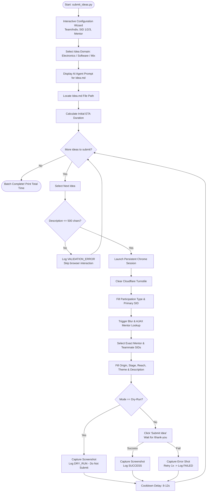

# 🚀 Youth Ideathon Automated Idea Submission Bot

<p align="center">
  
  
  
  
  
</p>

An intelligent, resilient, and human-like automation pipeline built with **Playwright Python** to sequentially batch-submit innovation proposals to the [Youth Ideathon Portal](https://youthideathon.in/submit-your-idea/).

Includes **interactive startup prompts**, **idea domain selector**, **built-in AI agent prompt generator**, **real-time completion time estimation (ETA)**, native **Markdown (`Idea.md`) parsing**, **dynamic AJAX mentor lookup**, **Cloudflare Turnstile bypass**, **character validation**, and **automatic screenshot auditing**.

---

## 📑 Table of Contents
- [Key Features](#-key-features)
- [Workflow Architecture](#-workflow-architecture)
- [Interactive Startup Wizard & AI Prompt Generator](#-interactive-startup-wizard--ai-prompt-generator)
- [AI Agent Prompt to Generate `Idea.md`](#-ai-agent-prompt-to-generate-ideamd)
- [Idea Catalog Format (`Idea.md`)](#-idea-catalog-format-ideamd)
  - [Standard Idea Template](#standard-idea-template)
  - [IRCTC Challenge Theme Template](#irctc-challenge-theme-template)
  - [Allowed Form Field Values](#allowed-form-field-values)
- [Estimated Completion Time (ETA)](#-estimated-completion-time-eta)
- [Quick Start](#-quick-start)
  - [1. Interactive Mode (Default)](#1-interactive-mode-default)
  - [2. Dry-Run Mode (Safe Verification)](#2-dry-run-mode-safe-verification)
  - [3. Non-Interactive CLI Mode](#3-non-interactive-cli-mode)
  - [4. Targeted Single-Idea Run](#4-targeted-single-idea-run)
- [CLI Reference](#-cli-reference)
- [Audit Logging & Evidence](#-audit-logging--evidence)
- [Cloudflare Bypass Mechanism](#-cloudflare-bypass-mechanism)
- [License](#-license)

---

## 🌟 Key Features

- **Interactive Startup Wizard**: On launch, interactively configures participation type (*Team* or *Individual*), SIDs, exact mentor string, idea domain, and file location.
- **Built-in AI Idea Generator Prompt**: Select your domain (*Electronics*, *Software*, or *Mix*), and the CLI outputs an optimized prompt ready to paste into ChatGPT, Claude, or Gemini to generate your `Idea.md`.
- **Dynamic File Locator**: Prompts you to specify or locate your custom `Idea.md` path on disk with validation.
- **Estimated Completion Time (ETA)**: Calculates batch ETA upfront based on delay parameters and dynamically reports remaining time and target finish time after every submission.
- **Direct Submissions (No Skipping)**: By default, submits all ideas present in the catalog file without arbitrary skipping.
- **Native Markdown Parser (`Idea.md`)**: Write and review ideas in formatted Markdown. Supports standard themes, IRCTC sub-themes, and custom blockquotes.
- **Dynamic AJAX Mentor Resolution**: Inputs primary SID (`YI26-11860`) and dispatches native `blur`/`change` events to trigger the portal's AJAX lookup (`action: yi26_get_mentors_by_sid`), automatically polling until the mentor option loads.
- **Dynamic Dropdown Handler**: Accurately selects options across origin, stage, projected reach, why great, main theme, and conditional IRCTC sub-themes.
- **Strict Pre-Validation**: Verifies idea descriptions are strictly $\le 500$ characters before launching or touching the browser, preventing portal rejections.
- **Undetectable Cloudflare Clearance**: Leverages persistent browser profiles with stealth flags (`--disable-blink-features=AutomationControlled`) to pass Cloudflare Turnstile verification.
- **Human-Like Pacing**:
  - $1.0\text{s} - 3.0\text{s}$ randomized pause between field inputs.
  - $8.0\text{s} - 12.0\text{s}$ randomized cooldown between idea submissions.
- **Fault-Tolerant Retries**: Retries failed attempts once with diagnostic error screenshots without crashing the batch run.
- **Audit Trails & Screenshots**: Captures pre-submission, dry-run, and confirmation screenshots for every idea into the `screenshots/` directory.

---

## 🔄 Workflow Architecture



---

## 💻 Interactive Startup Wizard & AI Prompt Generator

When launching `python submit_ideas.py`:

```text
==============================================================
      YOUTH IDEATHON 2026 - SUBMISSION CONFIGURATION
==============================================================
Press [Enter] to accept the suggested default value in [brackets].

1. Participation Type (Team / Individual) [Team]: 
2. SID 1 (Primary Student ID) [YI26-11860]: 
3. SID 2 (Teammate 1 SID) [YI26-08461]: 
4. SID 3 (Teammate 2 SID) [YI26-09892]: 
5. Mentor Name (exact detail, e.g. Name (Stream)) [Umesh Verma (ATL)]: 

--- Idea Domain & Generator Prompt ---
What type of ideas do you want to submit/create?
  [1] Electronic / Hardware / IoT
  [2] Software / AI / Mobile / Web
  [3] Mixed (Hardware + Software / DeepTech)
Select idea type [1/2/3] (default: 3): 1

================================================================================
>>> COPY & PASTE THIS PROMPT INTO ANY AI AGENT (ChatGPT / Claude / Gemini) <<<
================================================================================
... [Agent prompt is printed here for easy copy-pasting] ...

6. Locate your idea file path [Idea.md]: Idea.md

--- Active Submission Parameters ---
Participation Type : Team
Primary SID (SID 1): YI26-11860
Teammate 1 (SID 2) : YI26-08461
Teammate 2 (SID 3) : YI26-09892
Mentor (Exact)     : Umesh Verma (ATL)
Idea Catalog File  : Idea.md
==============================================================
```

---

## 🤖 AI Agent Prompt to Generate `Idea.md`

You can copy and paste the prompt below into ChatGPT, Claude, or Gemini to produce a ready-to-run `Idea.md`:

```text
You are an expert school/college innovation mentor for the Youth Ideathon 2026 competition.
Please generate an 'Idea.md' markdown file containing 10-15 novel, practical, and highly impactful
ideas in the domain: [Electronics / Software / Mixed].

Every idea MUST adhere strictly to the following markdown template:

### IDEA-01: [Title of Idea]
- **Theme:** [Select ONE: AI and Chip Innovation | Sustainability | Space | Next Billion Innovation Challenge | Supporting Girl Entrepreneurs | EdTech | IRCTC challenge | Open Innovation]
- **Origin:** [Select ONE: I read something like this in a book or internet | I faced this problem | My family or close friends faced this problem | I got this during a discussion with someone | From my teacher or mentor | Can't remember]
- **Stage:** [Select ONE: Idea Stage | User Research Stage | Design Stage | Early Prototyping Stage | Prototype Validation Stage | Already have few customers]
- **3-Year Projected Users:** [Select ONE: Less than 1,000 | 1,000 | 25,000 | 1,00,000 | 10,00,000 | More than 10,00,000]
- **Why Great:** [Select ONE: It solves a problem faced by many people | It solves a problem that has been unsolved for ages | I have already developed the solution | It is very innovative | It uses new technology | Other]
- **Description:**
> [Clear description strictly UNDER 500 characters explaining the problem, hardware/software architecture, and real-world impact. DO NOT EXCEED 500 CHARACTERS.]

*Important Guidelines:*
1. If Theme is 'IRCTC challenge', format as:
   - **Theme:** IRCTC challenge (Sub-theme)
   where Sub-theme is ONE of:
   - Innovation and Improvements in Railway Catering Services
   - Packaged Drinking Water
   - IRCTC- One Stop Shop Travel Solution
   - Think Ticketing, Think IRCTC
2. Ensure the description character count is strictly between 250 and 480 characters.
3. Do not include markdown code fence blocks inside descriptions.
```

---

## 📝 Idea Catalog Format (`Idea.md`)

### Standard Idea Template

```markdown
### IDEA-01: Smart Solar PV Self-Cleaning & Dust Detection Ring
- **Theme:** Sustainability
- **Origin:** I faced this problem
- **Stage:** Early Prototyping Stage
- **3-Year Projected Users:** 1,00,000
- **Why Great:** It solves a problem faced by many people
- **Description:**
> An automated, water-free wiper frame using electrostatic micro-brushes and solar-powered edge rollers. Dust accumulation reduces solar panel efficiency by up to 30% in dusty climates; this system tracks light reduction using photo-sensors and initiates automated mechanical dusting during non-peak hours, increasing net clean energy output without wasting potable water.
```

### IRCTC Challenge Theme Template

```markdown
### IDEA-03: AI Edge Vision for Real-Time Railway Track Debris Warning
- **Theme:** IRCTC challenge (IRCTC- One Stop Shop Travel Solution)
- **Origin:** I read something like this in a book or internet
- **Stage:** Idea Stage
- **3-Year Projected Users:** 10,00,000
- **Why Great:** It solves a problem that has been unsolved for ages
- **Description:**
> A solar-backed edge computing camera node for rail crossings and blind bends. Running lightweight YOLO vision models on local micro-NPUs, it detects fallen boulders, stalled vehicles, and wildlife intrusions within 300m, transmitting low-latency RF warning signals directly to locomotive telemetry and local signal boxes before visual range.
```

---

### Allowed Form Field Values

| Field | Accepted Exact Values on Portal |
|---|---|
| **Theme** | `AI and Chip Innovation`, `Sustainability`, `Space`, `Next Billion Innovation Challenge`, `Supporting Girl Entrepreneurs`, `EdTech`, `IRCTC challenge`, `Open Innovation` |
| **IRCTC Sub-theme** | `Innovation and Improvements in Railway Catering Services`, `Packaged Drinking Water`, `IRCTC- One Stop Shop Travel Solution`, `Think Ticketing, Think IRCTC` |
| **Origin** | `I read something like this in a book or internet`, `I faced this problem`, `My family or close friends faced this problem`, `I got this during a discussion with someone`, `From my teacher or mentor`, `Can't remember` |
| **Stage** | `Idea Stage`, `User Research Stage`, `Design Stage`, `Early Prototyping Stage`, `Prototype Validation Stage`, `Already have few customers` |
| **3-Year Projected Users** | `Less than 1,000`, `1,000`, `25,000`, `1,00,000`, `10,00,000`, `More than 10,00,000` |
| **Why Great** | `It solves a problem faced by many people`, `It solves a problem that has been unsolved for ages`, `I have already developed the solution`, `It is very innovative`, `It uses new technology`, `Other` |
| **Description** | Free text strictly **$\le 500$ characters**. |

---

## ⏱️ Estimated Completion Time (ETA)

At the start of execution, the engine displays an ETA summary and updates it as ideas are submitted:

```text
[INFO] ==============================================================
[INFO] [BATCH] Batch Submission Initialized
[INFO] [BATCH] Total Ideas to Submit : 15
[INFO] [ETA] Estimated Total Time    : ~7m 45s (~31s per idea)
[INFO] [ETA] Target Completion Time  : 13:15:29
[INFO] ==============================================================

[INFO] ==============================================================
[INFO] [SUBMITTING] (1/15): [IDEA-01] Smart Solar PV Self-Cleaning & Dust Detection Ring
[INFO] [ETA] Est. Remaining Time : ~7m 45s (Finish ~13:15:30)
[INFO] ==============================================================
...
[INFO] Completed [IDEA-01] in 28.2s -> Status: DRY_RUN
```

---

## 🚀 Quick Start

### 1. Interactive Mode (Default)
```powershell
python submit_ideas.py
```

### 2. Dry-Run Mode (Safe Verification)
```powershell
# Dry-run across all ideas
python submit_ideas.py --dry-run

# Dry-run only the first idea
python submit_ideas.py --dry-run --single-dry-run
```

### 3. Non-Interactive CLI Mode
```powershell
python submit_ideas.py `
  --non-interactive `
  --participation-type Team `
  --primary-sid "YI26-11860" `
  --sid-2 "YI26-08461" `
  --sid-3 "YI26-09892" `
  --mentor "Umesh Verma (ATL)" `
  --data-file "Idea.md"
```

### 4. Targeted Single-Idea Run
```powershell
python submit_ideas.py --dry-run --idea-id IDEA-03
```

---

## ⚙️ CLI Reference

| Flag | Default | Description |
|---|---|---|
| `--data-file <path>` | Auto-detects `Idea.md` | Path to `Idea.md`, `ideas.json`, or `ideas.csv` |
| `--dry-run` | `False` | Fills form and saves screenshot without submitting |
| `--single-dry-run` | `False` | Halts execution after one dry-run idea |
| `--idea-id <ID>` | `None` | Filters run to a specific idea (e.g. `IDEA-05`) |
| `--max-ideas <N>` | `None` | Caps total ideas submitted in the session |
| `--skip-existing` | `False` | Only skips ideas if explicitly passed |
| `--non-interactive` | `False` | Bypasses interactive startup prompts |
| `--participation-type` | `Team` | `Team` or `Individual` |
| `--primary-sid <SID>` | `YI26-11860` | Primary student ID (SID 1) |
| `--sid-2 <SID>` | `YI26-08461` | Teammate 1 ID (SID 2) |
| `--sid-3 <SID>` | `YI26-09892` | Teammate 2 ID (SID 3) |
| `--mentor <name>` | `Umesh Verma (ATL)` | Exact mentor text to select from dynamic list |
| `--headless` | `False` | Run browser in headless mode |
| `--log-file <path>` | `submission_log.csv` | Output audit CSV filepath |
| `--delay-inputs-min` | `1.0` | Minimum seconds between field inputs |
| `--delay-inputs-max` | `3.0` | Maximum seconds between field inputs |
| `--delay-submit-min` | `8.0` | Minimum cooldown between submissions (seconds) |
| `--delay-submit-max` | `12.0` | Maximum cooldown between submissions (seconds) |

---

## 📊 Audit Logging & Evidence

Every submission is appended to [`submission_log.csv`](submission_log.csv) with columns:
`idea_id, title, status, timestamp, screenshot_path, notes`

### Status Glossary
- `SUCCESS`: Submission verified and redirected to `/thank-you`.
- `DRY_RUN`: All inputs populated and screenshot saved; submit was not clicked.
- `SKIPPED`: Marked as skipped only if `--skip-existing` is supplied.
- `VALIDATION_ERROR`: Description exceeded 500 characters; blocked before browser launch.
- `FAILED`: Submission failed twice; diagnostic screenshot captured.

---

## 🛡️ Cloudflare Bypass Mechanism

The Youth Ideathon website utilizes **Cloudflare Turnstile** protection. Standard automated browsers are blocked by `navigator.webdriver` detection.

This automation utilizes:
1. **Persistent Chrome User Context** (`launch_persistent_context`).
2. `--disable-blink-features=AutomationControlled` to remove browser fingerprint flags.
3. Disabled automation extension (`ignore_default_args=["--enable-automation"]`).
4. Native window focus to clear challenges seamlessly without third-party captcha solvers.

---

## 📄 License

Distributed under the MIT License. See `LICENSE` for more information.

---

<p align="center">
  <b>Built for Youth Ideathon 2026 Innovation Submissions</b>
</p>
